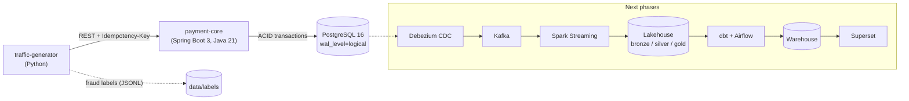

# KaaranguéPay — Mobile Money Data Platform

[](https://github.com/AlouCoding/kaarangepay-data-platform/actions/workflows/ci.yml)

> *Kaaraange* means **security / protection** in Wolof: the first promise of a payment system.

An end-to-end **data engineering** project built around a realistic mobile money
system, the kind of payment platform used by millions of people in West Africa.

A transactional core produces correct, realistic payment data: double-entry ledger,
idempotent API, fraud scenarios, paydays and holiday peaks. On top of it, a data
platform captures, streams, models and checks that data (phases 2–5).

> **Status: Phase 1 — transactional source** ✅
> KaaranguéPay is a fictional brand. Fee rules, traffic patterns and amounts are illustrative
> assumptions, not data from any real operator.

---

## Architecture



| Phase | Scope | Status |
|---|---|---|
| 1. Source | payment-core, double-entry ledger, idempotency, traffic generator, CI | ✅ |
| 2. Ingestion | Debezium CDC → Kafka (Avro + Schema Registry), bronze layer on MinIO | ⏳ |
| 3. Streaming | Spark Structured Streaming: silver/gold, real-time fraud features | ⏳ |
| 4. Batch & BI | Airflow + dbt star schema, data quality tests, reconciliation, Superset | ⏳ |
| 5. ML & polish | Fraud model with MLflow, observability, Kubernetes, demo video | ⏳ |

## Why this domain

Payments force real engineering decisions: money must never be created, lost or
moved twice. Correct data at the source is what makes everything downstream
trustworthy, so phase 1 focuses on **correctness first**.

## Key design decisions

Each decision is documented as an [ADR](docs/adr). A French walkthrough with workflow diagrams is in [docs/GUIDE-FR.md](docs/GUIDE-FR.md), and the engineering log (issues found, root causes, fixes) in [docs/JOURNAL-FR.md](docs/JOURNAL-FR.md).

| ADR | Decision |
|---|---|
| [0001](docs/adr/0001-modular-monolith-for-the-transactional-core.md) | Modular monolith: every payment is a single ACID transaction |
| [0002](docs/adr/0002-double-entry-ledger.md) | Double-entry ledger with a treasury account → the sum of all balances is always 0 |
| [0003](docs/adr/0003-idempotency-keys.md) | Mandatory idempotency keys: a retried request never debits twice |
| [0004](docs/adr/0004-event-time-vs-processing-time.md) | Event time vs processing time, with a dev-only simulated clock for backfills |
| [0005](docs/adr/0005-integer-amounts-in-xof.md) | Integer amounts in XOF, fees in basis points |

### Concurrency
Accounts are locked with `SELECT … FOR UPDATE` **in a global id order**, so concurrent
transfers between the same wallets serialise without deadlocks. This is verified by a
test running 16 threads × 250 random transfers across 20 wallets, checking that no
money is created or destroyed.

### Ledger integrity, checkable at any time
```bash
curl localhost:8080/api/v1/ledger/integrity
# {"sumOfBalances":0,"unbalancedTransactions":0,"accountsWithDrift":0,"healthy":true}
```
The same three invariants will be re-checked in the warehouse with dbt tests (phase 4).
Comparing both sides is a real OLTP ↔ analytics reconciliation.

## Data model

| Table | Content |
|---|---|
| `accounts` | Wallets: `CUSTOMER`, `MERCHANT`, `AGENT`, `SYSTEM` (treasury, fees) |
| `transactions` | Every request with an outcome, **including failed ones** (`INSUFFICIENT_FUNDS`, `ACCOUNT_BLOCKED`) |
| `ledger_entries` | Immutable debit/credit lines with `balance_after` |

Transaction types follow the vocabulary of the public **PaySim** dataset:
`CASH_IN`, `CASH_OUT`, `PAYMENT`, `TRANSFER`, plus `FLOAT_TOPUP` (treasury → agent).

## Realistic traffic

The generator models a non-homogeneous Poisson process (Lewis-Shedler thinning) on top of:

- a day/night cycle with lunch and evening peaks;
- paydays (25th of the month to the 3rd);
- a calmer Sunday;
- holidays, with a strong peak in the days **before Tabaski and Korité** (2026 dates are approximate);
- heavy users (Pareto) and popular merchants (Zipf);
- **fraud**: account takeover → the victim is drained by a `TRANSFER` to a mule, who then does a `CASH_OUT` 2–30 minutes later. Ground-truth labels are written to `data/labels/fraud_labels.jsonl` (never sent to the API);
- client retries with the same idempotency key, which must be replayed, not re-executed.

## Quick start

Only **Docker** is required (Java, Maven and Python run inside containers).

```bash
# 1. Start Postgres + payment-core on http://localhost:8080
docker compose up -d --build postgres payment-core

# 2. Generate 30 days of history (November 2026)
docker compose --profile traffic run --rm traffic-generator \
  --base-url http://payment-core:8080 --rate 300 backfill --start 2026-11-01 --days 30

# 3. Check the ledger invariants
curl http://localhost:8080/api/v1/ledger/integrity

# 4. Explore the data
docker compose exec postgres psql -U mmplatform -d mmplatform
```

With `make` installed (Linux/macOS): `make up`, `make backfill`, `make integrity`, `make psql`.
If port 8080 is taken, set `APP_PORT` (e.g. `APP_PORT=8082`).

> On a run of 30 simulated days on a laptop: **134,335 API calls at ~205 tx/s**,
> 1,329 idempotent replays, and the ledger invariants still at zero.

Example API calls:

```bash
# Open a wallet
curl -s -X POST localhost:8080/api/v1/accounts -H 'Content-Type: application/json' \
  -d '{"phone":"+221771234567","ownerName":"Awa Diop","type":"CUSTOMER"}'

# Move money (the idempotency key is mandatory)
curl -s -X POST localhost:8080/api/v1/transactions \
  -H 'Content-Type: application/json' -H "Idempotency-Key: $(uuidgen)" \
  -d '{"type":"TRANSFER","sourceAccountId":"…","destinationAccountId":"…","amount":10000}'
```

| Status | Meaning |
|---|---|
| `201` | Completed |
| `200` | Completed earlier: replayed (`Idempotent-Replay: true`) |
| `422` | Refused (recorded as `FAILED`) or invalid routing (not recorded) |
| `409` | Idempotency key reused with a different payload |

Metrics are exposed for Prometheus on `/actuator/prometheus` (`mm_transactions_total`,
`mm_transactions_latency_seconds`).

## Tests

```bash
# Java tests in a Maven container (Testcontainers starts a throwaway PostgreSQL)
cd payment-core
docker run --rm -v "$PWD:/app" -w /app -v m2cache:/root/.m2 \
  -v /var/run/docker.sock:/var/run/docker.sock \
  -e TESTCONTAINERS_HOST_OVERRIDE=host.docker.internal \
  maven:3.9-eclipse-temurin-21 mvn -B verify
```
(On Windows `cmd`, replace `$PWD` with `%cd%` and put the command on one line.
With Java 21 + Maven installed: `mvn verify`, or `make test` for everything.)

**26 tests, all green:**

- **payment-core**: unit tests (fees, routing, hashing, clock) and integration tests
  against a real PostgreSQL with **Testcontainers**: money flows, failures, idempotent
  replays, key conflicts, blocked accounts, concurrency and exactly-once under
  concurrent retries. Every API test ends with a ledger integrity check.
- **traffic-generator**: `pytest`, `ruff`, `mypy --strict`. It is tested against an
  in-memory fake that applies the same business rules.

The concurrency test fires 10 identical requests at the same time: PostgreSQL rejects 9 of them on the
`UNIQUE` idempotency key and the service replays the first result. **Exactly-once is enforced by the
database, not by an `if` in Java code.**

CI runs both on every push (GitHub Actions).

## Project structure

```
├── payment-core/          Spring Boot service (account, ledger, transaction modules)
│   └── src/main/resources/db/migration   Flyway migrations
├── traffic-generator/     Python package `mmgen`
├── docs/adr/              Architecture Decision Records
├── docs/GUIDE-FR.md       Walkthrough with workflow diagrams (French)
├── docs/JOURNAL-FR.md     Engineering log: issues, root causes, fixes (French)
├── docker-compose.yml
└── Makefile
```

## Known limitations (by design, for now)

- The FEES and TREASURY rows are hot spots under very high load (see ADR 0002).
- No authentication yet: the API is meant to run on a private network in this project.
- `X-Simulated-Time` exists for backfills only and is disabled by default.
- The traffic generator currently over-drains customer wallets (16–31 % refused payments);
  rebalancing money flows is the next fix (v1.1). See the engineering log.
