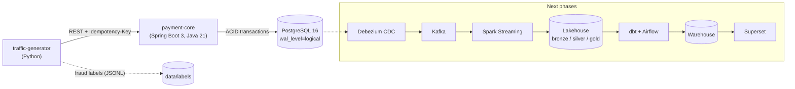

# KaaranguéPay — Mobile Money Data Platform

[](https://github.com/AlouCoding/kaarangepay-data-platform/actions/workflows/ci.yml)

> *Kaaraange* means **security / protection** in Wolof: the first promise of a payment system.

An end-to-end **data engineering** project built around a realistic mobile money
system, the kind of payment platform used by millions of people in West Africa.

A transactional core produces correct, realistic payment data: double-entry ledger,
idempotent API, fraud scenarios, paydays and holiday peaks. On top of it, a data
platform captures, streams, models and checks that data (phases 2–5).

> **Status: Phase 1 — transactional source** ✅ · **Phase 2a — CDC with Debezium + Kafka** ✅ · **Phase 2b — bronze layer** ✅ · **Phase 3a — silver (Spark + Delta)** ✅ · **Phase 3b — streaming fraud detection** ✅ · **Phase 4 — dbt + app** ✅
> KaaranguéPay is a fictional brand. Fee rules, traffic patterns and amounts are illustrative
> assumptions, not data from any real operator.

---

## Architecture



| Phase | Scope | Status |
|---|---|---|
| 1. Source | payment-core, double-entry ledger, idempotency, traffic generator, CI | ✅ |
| 2a. CDC | Debezium reads PostgreSQL's WAL → one Kafka topic per table, Kafka UI, reconciliation | ✅ |
| 2b. Bronze | Own Kafka consumer → raw CDC events as Parquet on S3-compatible storage (SeaweedFS), exactly-once effect | ✅ |
| 3a. Silver | Spark rebuilds current-state Delta tables from bronze; ledger invariants re-checked on the lake | ✅ |
| 3b. Streaming | Spark Structured Streaming on Kafka: stream-stream join (mule pattern), watermark, alerts topic + gold Delta, precision/recall vs labels | ✅ |
| 4. Analytics & app | dbt star schema on DuckDB, dbt tests (ledger invariants), atomic publication, Streamlit business view + live fraud console | ✅ |
| 4c. Orchestration | Airflow DAG calling the same commands | ⏳ |
| 5. ML & polish | Fraud model with MLflow, observability, Kubernetes, demo video | ⏳ |

## Why this domain

Payments force real engineering decisions: money must never be created, lost or
moved twice. Correct data at the source is what makes everything downstream
trustworthy, so phase 1 focuses on **correctness first**.

## Key design decisions

Each decision is documented as an [ADR](docs/adr). A French walkthrough with workflow diagrams is in [docs/GUIDE-FR.md](docs/GUIDE-FR.md), and the engineering log (issues found, root causes, fixes) in [docs/JOURNAL-FR.md](docs/JOURNAL-FR.md).

| ADR | Decision |
|---|---|
| [0001](docs/adr/0001-modular-monolith-for-the-transactional-core.md) | Modular monolith: every payment is a single ACID transaction |
| [0002](docs/adr/0002-double-entry-ledger.md) | Double-entry ledger with a treasury account → the sum of all balances is always 0 |
| [0003](docs/adr/0003-idempotency-keys.md) | Mandatory idempotency keys: a retried request never debits twice |
| [0004](docs/adr/0004-event-time-vs-processing-time.md) | Event time vs processing time, with a dev-only simulated clock for backfills |
| [0005](docs/adr/0005-integer-amounts-in-xof.md) | Integer amounts in XOF, fees in basis points |
| [0006](docs/adr/0006-change-data-capture-with-debezium.md) | Log-based CDC with Debezium instead of polling or dual writes |
| [0007](docs/adr/0007-bronze-layer-writer.md) | Bronze layer: own consumer, write-then-commit, deterministic file keys, SeaweedFS instead of MinIO |
| [0008](docs/adr/0008-silver-layer-spark-delta.md) | Silver layer: Spark full rebuild into Delta Lake, latest event per key by Kafka offset, quality gate |
| [0009](docs/adr/0009-streaming-fraud-detection.md) | Real-time fraud: stream-stream join on event time, 45-min watermark, checkpoints, measured precision/recall |
| [0010](docs/adr/0010-analytics-dbt-duckdb-streamlit.md) | Analytics: dbt on DuckDB, atomic publication only if all tests pass, Streamlit business view + fraud console |

### Concurrency
Accounts are locked with `SELECT … FOR UPDATE` **in a global id order**, so concurrent
transfers between the same wallets serialise without deadlocks. This is verified by a
test running 16 threads × 250 random transfers across 20 wallets, checking that no
money is created or destroyed.

### Ledger integrity, checkable at any time
```bash
curl localhost:8080/api/v1/ledger/integrity
# {"sumOfBalances":0,"unbalancedTransactions":0,"accountsWithDrift":0,"healthy":true}
```
The same three invariants will be re-checked in the warehouse with dbt tests (phase 4).
Comparing both sides is a real OLTP ↔ analytics reconciliation.

## Change Data Capture (phase 2a)

```bash
docker compose --profile cdc up -d     # Kafka (KRaft) + Debezium + Kafka UI on http://localhost:8090
curl http://localhost:8083/connectors/kaarangepay-postgres/status
```

Debezium reads PostgreSQL's write-ahead log and publishes every committed change to
`kaarangepay.public.{accounts,transactions,ledger_entries}`, keyed by primary key so that all
changes of a row stay ordered. `transactions` and `ledger_entries` are insert-only, so the
pipeline is reconciled with a simple rule: **messages in the topic = rows in the table**.

Measured on a laptop: initial snapshot of the whole database in **~18 s**, then live streaming;
**133,845 transactions and 309,668 ledger entries in Kafka, exactly matching PostgreSQL (0 gap)**.
Walkthrough (French): [docs/GUIDE-PHASE2-FR.md](docs/GUIDE-PHASE2-FR.md).

## Bronze layer (phase 2b)

```bash
docker compose --profile cdc --profile bronze up -d --build   # SeaweedFS + bronze-writer
docker compose --profile cdc --profile bronze run --rm bronze-writer reconcile
```

`bronze-writer` is a small Python consumer: it batches events **per partition**, writes a Parquet
file, and commits the Kafka offset **only after** the write. File keys depend only on the batch's
first offset (`transactions/dt=…/partition=2/offset=000000044794.parquet`), so a crash between write
and commit leads to an **overwrite, not a duplicate**: exactly-once effect on top of at-least-once
delivery. The reconcile command proves it: per partition, offsets are contiguous, with no gap and no
duplicate.

Measured result (first full run):

| Table | Rows in Parquet | Files | Rows in PostgreSQL | Gaps | Duplicates |
|---|---|---|---|---|---|
| `transactions` | 133,845 | 27 | 133,845 | 0 | 0 |
| `ledger_entries` | 309,668 | 63 | 309,668 | 0 | 0 |
| `accounts` (change events) | 2,172 | 3 | — | 0 | 0 |

The end-to-end chain **PostgreSQL → Debezium → Kafka → Parquet** loses nothing and duplicates nothing.

## Silver layer (phase 3a)

```bash
docker compose --profile cdc --profile bronze --profile lake run --rm lake silver
```

A PySpark job (`lakehouse/`) decodes each raw Debezium envelope, keeps the **latest event per primary
key** (ordered by Kafka offset, deletes remove the key), casts the columns and atomically overwrites a
**Delta Lake** table on S3. It then re-checks **on the lake** the same three ledger invariants that
payment-core checks in PostgreSQL (sum of balances = 0, every transaction balanced, balance = sum of
entries), plus key uniqueness and referential integrity. A single lost event fails the run (tested).

Measured result (first full run, Spark 3.5.8 local mode):

| Table | Bronze events | Silver rows | Rejected |
|---|---|---|---|
| `accounts` | 2,172 | 1,112 | 0 |
| `transactions` | 133,845 | 133,845 | 0 |
| `ledger_entries` | 309,668 | 309,668 | 0 |

**10/10 quality checks passed**: the money counted in PostgreSQL and the money counted in Delta Lake,
after Debezium, Kafka, bronze and Spark, match to the last franc.

## Real-time fraud detection (phase 3b)

```bash
docker compose --profile cdc --profile bronze --profile lake run --rm lake fraud        # Kafka -> alerts
docker compose --profile cdc --profile bronze --profile lake run --rm lake fraud-eval   # precision / recall
```

The generator simulates account takeovers: a victim's wallet is drained to a **mule**, who withdraws it as
cash minutes later. A velocity rule cannot see it (2 moves only); the signal is the **link** between the
moves. A Spark Structured Streaming job reads Kafka, joins incoming transfers with cash-outs **on event
time** (`occurred_at`, 30-min bound, 45-min watermark so state stays bounded), and publishes alerts to
`kaarangepay.fraud.alerts` and a gold Delta table, with checkpoints on S3. Detection quality is
**measured** against the generator's ground-truth labels, not claimed.

| Metric (first full run, ~134k transactions) | Value |
|---|---|
| Alerts | 261 |
| Precision (flagged transactions that are fraud) | **93.9 %** |
| Recall (fraudulent transactions flagged) | **99.6 %** |
| Fraud cases detected | 245 / 246 |

Honest reading: the simulated fraud follows exactly the pattern the rule looks for, so these numbers are an upper
bound. The false positives are honest customers who withdraw a transfer right away (e.g. remittances) — the
limit of a context-free rule, to be addressed with ML in phase 5.

## Analytics and end-user app (phase 4)

```bash
docker compose --profile cdc --profile bronze --profile lake --profile analytics run --rm analytics pipeline
docker compose --profile cdc --profile bronze --profile lake --profile analytics up -d dashboard   # http://localhost:8501
```

`analytics pipeline` reads the silver and gold **Delta** tables (through their transaction log, with delta-rs),
builds a **dbt star schema** on DuckDB (`fct_transactions`, `dim_account`, `dim_date`, daily/type/hour aggregates,
`fct_fraud_alerts`) and runs **dbt tests**, including the ledger invariants a third time. The new warehouse is
swapped in **atomically, only if every test passed**: users never see wrong or half-built numbers.

A **Streamlit** app serves two end users:
- **Vue métier** (management): volume, fees, failure rate, payday effect, activity heatmap.
- **Console fraude** (fraud analyst): live alerts from the streaming job, money path victim → mule → agent,
  *confirm fraud* / *false positive* buttons. Decisions are stored apart and become training labels for phase 5.

First run: `dbt build` **PASS=32, ERROR=0** (2.8 s); the app shows 133,845 transactions, **6.6 M XOF of fees** — the same
figure as the FEES ledger account measured in phase 1 (6,630,233 XOF), computed independently — a 2.3 % failure rate,
and a ×3 volume on payday days (25th → 3rd).

## Data model

| Table | Content |
|---|---|
| `accounts` | Wallets: `CUSTOMER`, `MERCHANT`, `AGENT`, `SYSTEM` (treasury, fees) |
| `transactions` | Every request with an outcome, **including failed ones** (`INSUFFICIENT_FUNDS`, `ACCOUNT_BLOCKED`) |
| `ledger_entries` | Immutable debit/credit lines with `balance_after` |

Transaction types follow the vocabulary of the public **PaySim** dataset:
`CASH_IN`, `CASH_OUT`, `PAYMENT`, `TRANSFER`, plus `FLOAT_TOPUP` (treasury → agent).
Merchants can also `CASH_OUT` their takings at an agent, so money keeps circulating.

## Realistic traffic

The generator models a non-homogeneous Poisson process (Lewis-Shedler thinning) on top of:

- a day/night cycle with lunch and evening peaks;
- paydays (25th of the month to the 3rd);
- a calmer Sunday;
- holidays, with a strong peak in the days **before Tabaski and Korité** (2026 dates are approximate);
- heavy users (Pareto) and popular merchants (Zipf);
- **balance-aware customers**: they spend within their balance, except a deliberate ~3 % of
  over-spending attempts; an empty wallet leads to a `CASH_IN` at an agent;
- salaries during the payday period, and merchants withdrawing their takings;
- **fraud**: account takeover → the victim is drained by a `TRANSFER` to a mule, who then does a `CASH_OUT` 2–30 minutes later. Ground-truth labels are written to `data/labels/fraud_labels.jsonl` (never sent to the API);
- client retries with the same idempotency key, which must be replayed, not re-executed.

## Quick start

Only **Docker** is required (Java, Maven and Python run inside containers).

```bash
# 1. Start Postgres + payment-core on http://localhost:8080
docker compose up -d --build postgres payment-core

# 2. Generate 30 days of history (November 2026)
docker compose --profile traffic run --rm traffic-generator \
  --base-url http://payment-core:8080 --rate 300 backfill --start 2026-11-01 --days 30

# 3. Check the ledger invariants
curl http://localhost:8080/api/v1/ledger/integrity

# 4. Explore the data
docker compose exec postgres psql -U mmplatform -d mmplatform
```

With `make` installed (Linux/macOS): `make up`, `make backfill`, `make integrity`, `make psql`.
If port 8080 is taken, set `APP_PORT` (e.g. `APP_PORT=8082`).

> On a run of 30 simulated days on a laptop (generator v1.1): **134,004 API calls at ~328 calls/s**,
> 2.3 % refused payments, 1,269 idempotent replays, and the ledger invariants still at zero.

Example API calls:

```bash
# Open a wallet
curl -s -X POST localhost:8080/api/v1/accounts -H 'Content-Type: application/json' \
  -d '{"phone":"+221771234567","ownerName":"Awa Diop","type":"CUSTOMER"}'

# Move money (the idempotency key is mandatory)
curl -s -X POST localhost:8080/api/v1/transactions \
  -H 'Content-Type: application/json' -H "Idempotency-Key: $(uuidgen)" \
  -d '{"type":"TRANSFER","sourceAccountId":"…","destinationAccountId":"…","amount":10000}'
```

| Status | Meaning |
|---|---|
| `201` | Completed |
| `200` | Completed earlier: replayed (`Idempotent-Replay: true`) |
| `422` | Refused (recorded as `FAILED`) or invalid routing (not recorded) |
| `409` | Idempotency key reused with a different payload |

Metrics are exposed for Prometheus on `/actuator/prometheus` (`mm_transactions_total`,
`mm_transactions_latency_seconds`).

## Tests

```bash
# Java tests in a Maven container (Testcontainers starts a throwaway PostgreSQL)
cd payment-core
docker run --rm -v "$PWD:/app" -w /app -v m2cache:/root/.m2 \
  -v /var/run/docker.sock:/var/run/docker.sock \
  -e TESTCONTAINERS_HOST_OVERRIDE=host.docker.internal \
  maven:3.9-eclipse-temurin-21 mvn -B verify
```
(On Windows `cmd`, replace `$PWD` with `%cd%` and put the command on one line.
With Java 21 + Maven installed: `mvn verify`, or `make test` for everything.)

**27 tests, all green:**

- **payment-core**: unit tests (fees, routing, hashing, clock) and integration tests
  against a real PostgreSQL with **Testcontainers**: money flows, failures, idempotent
  replays, key conflicts, blocked accounts, concurrency and exactly-once under
  concurrent retries. Every API test ends with a ledger integrity check.
- **traffic-generator**: `pytest`, `ruff`, `mypy --strict`. It is tested against an
  in-memory fake that applies the same business rules.

The concurrency test fires 10 identical requests at the same time: PostgreSQL rejects 9 of them on the
`UNIQUE` idempotency key and the service replays the first result. **Exactly-once is enforced by the
database, not by an `if` in Java code.**

CI runs both on every push (GitHub Actions).

## Project structure

```
├── payment-core/          Spring Boot service (account, ledger, transaction modules)
│   └── src/main/resources/db/migration   Flyway migrations
├── traffic-generator/     Python package `mmgen`
├── bronze-writer/         Kafka → Parquet → S3 consumer (phase 2b)
├── lakehouse/             PySpark jobs: bronze → silver Delta tables + quality checks (phase 3)
├── analytics/             dbt star schema on DuckDB + Streamlit app (phase 4)
├── cdc/connectors/        Debezium connector configuration
├── docs/adr/              Architecture Decision Records
├── docs/GUIDE-FR.md       Walkthrough with workflow diagrams (French)
├── docs/JOURNAL-FR.md     Engineering log: issues, root causes, fixes (French)
├── docker-compose.yml
└── Makefile
```

## Known limitations (by design, for now)

- The FEES and TREASURY rows are hot spots under very high load (see ADR 0002).
- No authentication yet: the API is meant to run on a private network in this project.
- `X-Simulated-Time` exists for backfills only and is disabled by default.
- Fixed in v1.1: the first generator drained customer wallets (16–31 % refused payments, 70 % of
  the money stuck at merchants). Flows are now balanced: 2.3 % refusals measured on a 30-day run.
  Next tuning (v1.2): customers accumulate too much (salaries) and merchants keep almost nothing.
  See the engineering log for the investigation.
