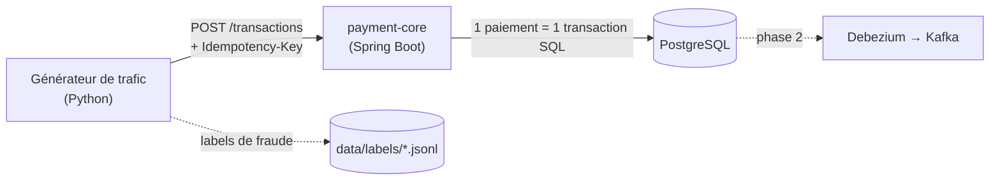
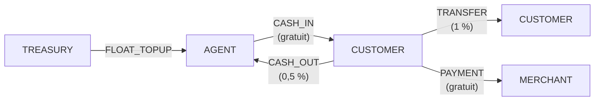
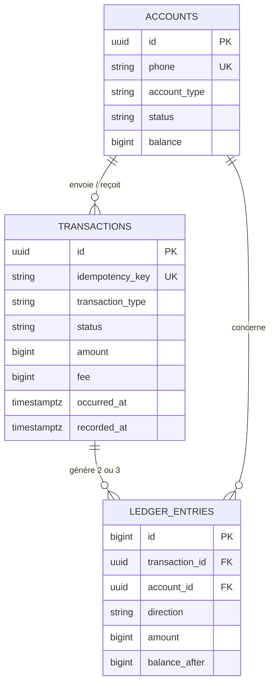
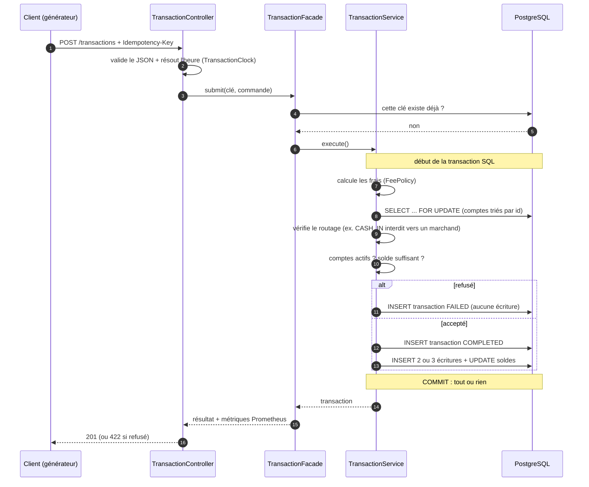
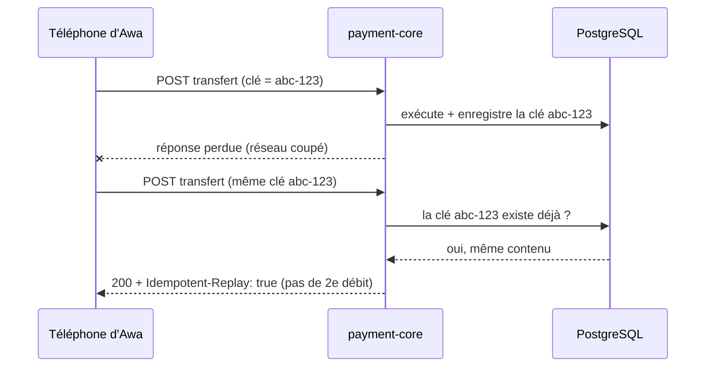
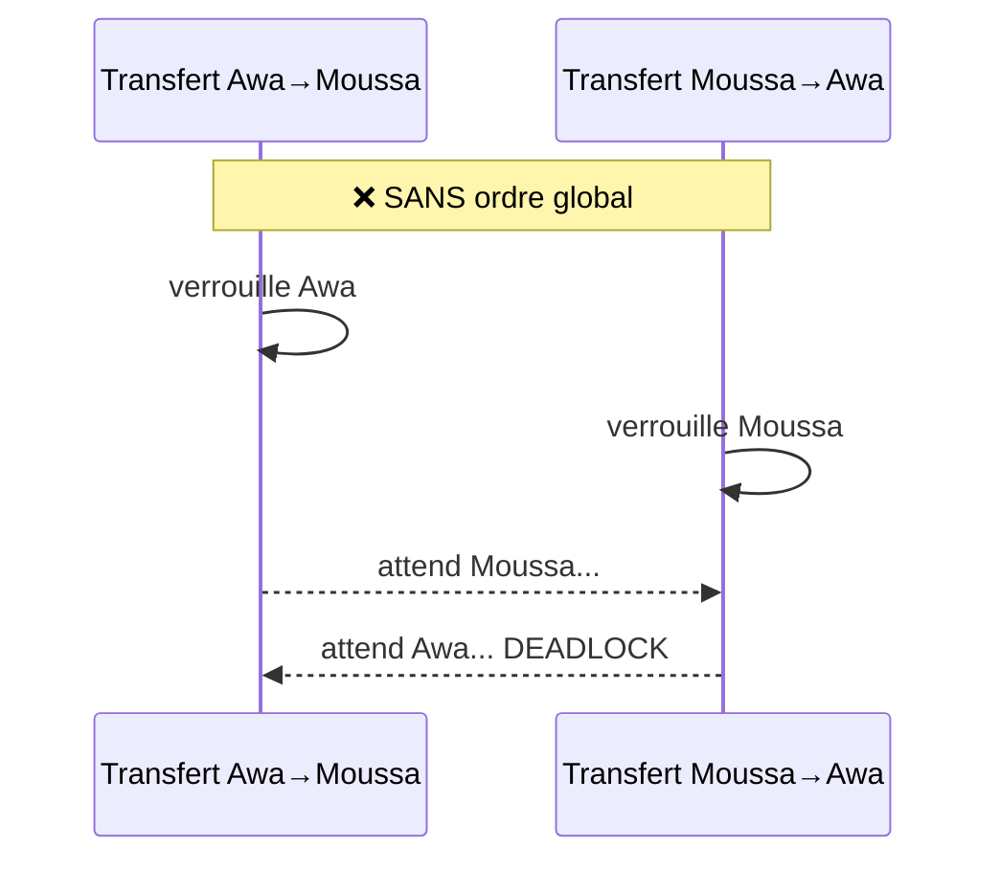
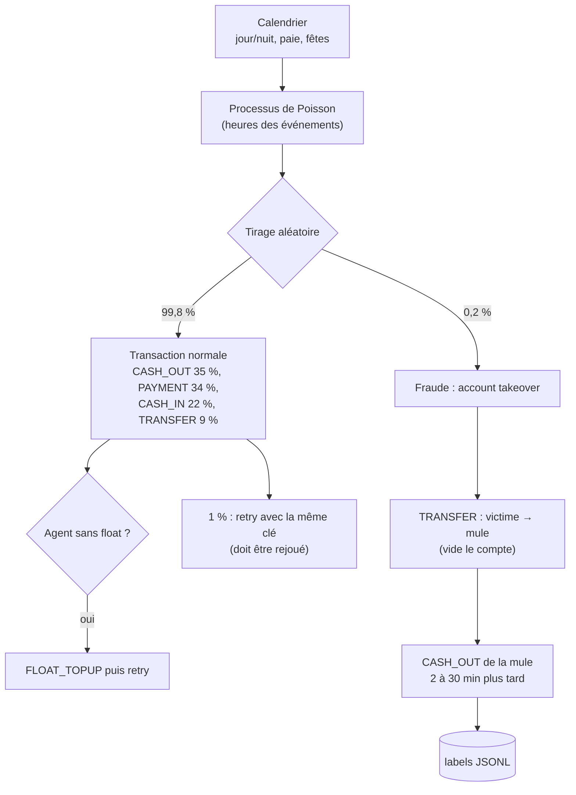

# KaaranguéPay — Guide de la phase 1

> *Kaaraange* = sécurité, protection en wolof. Le nom porte la promesse du projet : l'argent est protégé, rien ne se perd, rien ne se crée.

> Ce guide sert à **comprendre** le code et à **l'expliquer en entretien**.
> Les schémas (Mermaid) s'affichent directement sur GitHub.

---

## 1. Vue d'ensemble

**En une phrase :** le générateur simule des milliers de clients qui envoient de l'argent ;
`payment-core` exécute chaque paiement sans jamais perdre ni créer un franc ;
PostgreSQL garde des données **justes**, que la plateforme data exploitera ensuite.

**Pourquoi commencer par là ?** En data engineering, si la source est fausse, tout
ce qui est en aval (dashboards, modèles ML) est faux. La phase 1 garantit une source fiable.

---

## 2. Les acteurs (types de comptes)

| Type | Qui c'est | Exemple réel |
|---|---|---|
| `CUSTOMER` | Un client avec un portefeuille mobile | Awa, qui envoie de l'argent à sa mère |
| `AGENT` | Un point de dépôt / retrait | La boutique du coin qui fait du cash-in / cash-out |
| `MERCHANT` | Un commerçant qui reçoit des paiements | Une pharmacie, une boulangerie |
| `SYSTEM` TREASURY | Le « trésor » de la plateforme : représente l'argent électronique émis | Le compte en banque qui garantit la monnaie électronique |
| `SYSTEM` FEES | Où vont les frais | Le chiffre d'affaires de l'opérateur |

## 3. Les 5 types de transactions

- **FLOAT_TOPUP** : l'agent dépose du cash à la banque et reçoit de la monnaie électronique (« float »).
- **CASH_IN** : un client donne du cash à l'agent et reçoit de l'argent sur son téléphone.
- **CASH_OUT** : l'inverse, un retrait.
- **TRANSFER** : d'un client à un autre.
- **PAYMENT** : d'un client à un commerçant.

Ces noms viennent du dataset public **PaySim** : on pourra comparer nos données avec lui.
Les frais (1 %, 0,5 %, plafond 5 000 XOF) sont **fictifs** et configurables dans `application.yml`.

---

## 4. Le modèle de données

| Table | Rôle | À retenir |
|---|---|---|
| `accounts` | Les portefeuilles | `balance` est un **cache** : la vérité, ce sont les écritures |
| `transactions` | Chaque demande et son résultat | Les échecs sont **gardés** (`FAILED`) : c'est de la donnée utile |
| `ledger_entries` | Le grand livre comptable | Jamais modifié, jamais supprimé (immuable) |

---

## 5. Le ledger en partie double (le cœur du projet)

**Principe comptable :** chaque mouvement d'argent s'écrit sur **au moins deux lignes**.
Ce qui sort d'un compte entre forcément dans un autre.

**Exemple : Awa envoie 10 000 XOF à Moussa (frais 1 % = 100 XOF)**

| Compte | Sens | Montant | Effet |
|---|---|---|---|
| Awa | DEBIT | 10 100 | −10 100 |
| Moussa | CREDIT | 10 000 | +10 000 |
| FEES | CREDIT | 100 | +100 |
| **Total** | | | **0** ✅ |

**L'astuce du TREASURY :** quand l'agent reçoit 5 000 000 XOF de float, le TREASURY passe à
−5 000 000. Résultat : **la somme de TOUS les soldes vaut toujours 0**. Si un jour elle
vaut 3, un bug a créé 3 francs, et on le détecte immédiatement.

**Les 3 invariants vérifiés par `GET /api/v1/ledger/integrity` :**
1. somme de tous les soldes = 0 ;
2. dans chaque transaction, débits = crédits ;
3. solde de chaque compte = somme de ses crédits − somme de ses débits.

---

## 6. Workflow d'un transfert, étape par étape

**Qui fait quoi dans le code :**

| Classe | Responsabilité |
|---|---|
| `TransactionController` | HTTP : headers, validation, codes de réponse |
| `TransactionFacade` | Idempotence + métriques (volontairement **sans** transaction SQL) |
| `TransactionService` | La logique métier dans **une** transaction SQL |
| `FeePolicy` | Calcul des frais en entiers |
| `TransactionClock` | Heure de l'événement (réelle ou simulée) |
| `LedgerIntegrityService` | Vérification des 3 invariants |

---

## 7. L'idempotence : pourquoi un retry ne débite jamais deux fois

**Le problème :** le réseau coupe juste après que le serveur a débité Awa.
Son téléphone ne reçoit pas la réponse et renvoie la demande. Sans protection, Awa est débitée deux fois.

| Situation | Réponse |
|---|---|
| Clé nouvelle | Exécute → `201` |
| Même clé, même contenu | Rejoue l'ancien résultat → `200` |
| Même clé, contenu différent | Erreur → `409 Conflict` |
| 2 requêtes identiques **en même temps** | La 2ᵉ attend, tombe sur la contrainte `UNIQUE`, puis rejoue le résultat de la 1ʳᵉ |

C'est le même principe que l'API de Stripe.

---

## 8. La concurrence : comment éviter les deadlocks

**Le danger :** au même moment, Awa envoie à Moussa et Moussa envoie à Awa.

**La solution :** on verrouille **toujours dans le même ordre** (tri par id), quel que soit
le sens du transfert. Les deux transactions veulent d'abord le même compte : la seconde
attend simplement que la première ait fini. Plus de cycle, donc plus de deadlock.

C'est ce que fait `AccountRepository.lockAllByIdIn` (`... ORDER BY a.id` + `PESSIMISTIC_WRITE`).

**Preuve par les tests :** `LedgerConcurrencyIntegrationTest` lance 16 threads × 250 transferts
aléatoires entre les 20 mêmes comptes, puis vérifie qu'aucun franc n'a été créé ou perdu.

---

## 9. Event time vs processing time

| Colonne | Signification | Exemple |
|---|---|---|
| `occurred_at` | **Quand** le paiement a eu lieu pour le client | 25 nov. 18 h 45 |
| `recorded_at` | **Quand** le serveur l'a écrit | maintenant |

Pourquoi deux colonnes ? En streaming (phase 3), les données arrivent parfois **en retard**.
Spark utilise l'event time et des *watermarks* pour les placer dans la bonne fenêtre.
Le générateur peut simuler l'event time avec le header `X-Simulated-Time`, ce qui permet de
générer 30 jours d'historique en quelques minutes. **Ce mode est réservé au dev.**

---

## 10. Le générateur de trafic

**Ce qui rend les données réalistes :**
- **Le calendrier** : nuits calmes, pics à midi et le soir, paie du 25 au 3, et un fort pic
  dans les jours **avant Tabaski et Korité** (dates 2026 approximatives).
- **Les gros utilisateurs** (loi de Pareto) et **les commerçants populaires** (loi de Zipf).
- **Les montants** suivent une loi log-normale, arrondis à 25 XOF.
- **La fraude** suit le schéma de PaySim : vider un compte vers une « mule » qui retire vite le cash.
- **Les labels** : en vrai, on découvre la fraude plus tard (plainte, enquête). Le générateur
  écrit la vérité dans un fichier séparé. L'API ne la voit jamais. En phase 4, ces labels
  serviront à entraîner et évaluer le modèle de fraude.

---

## 11. Comment l'expliquer en entretien

**Pitch de 30 secondes :**
> « J'ai construit une plateforme data autour d'un système de mobile money. La source
> transactionnelle est un service Spring Boot avec un ledger en partie double : la somme de
> tous les soldes vaut toujours zéro, ce qui rend toute erreur détectable. Les paiements sont
> idempotents et testés en concurrence avec Testcontainers. Un générateur Python produit un
> trafic réaliste (paie, Tabaski, fraude) avec des labels de vérité terrain. La suite du
> projet capture ces données par CDC avec Debezium vers Kafka, puis les traite avec Spark et dbt. »

**Questions probables et réponses courtes :**

| Question | Ta réponse |
|---|---|
| Pourquoi pas des microservices ? | Un paiement touche 3 comptes. En microservices, il faudrait une Saga distribuée. Le projet est centré sur la data, donc j'ai choisi la cohérence ACID et des modules séparables plus tard (ADR 0001). |
| Pourquoi `long` et pas `double` ? | Les flottants ne représentent pas l'argent exactement. Le XOF n'a pas de centimes, donc des entiers suffisent (ADR 0005). |
| Comment évites-tu le double débit ? | Une clé d'idempotence obligatoire, en `UNIQUE` en base, plus un hash du contenu pour détecter une réutilisation (ADR 0003). |
| Et les deadlocks ? | Les verrous sont toujours pris dans l'ordre des ids. C'est testé avec 16 threads. |
| Une limite de ton design ? | Les comptes FEES et TREASURY sont des « hot rows » sous très forte charge. Piste : accumuler les frais en asynchrone (ADR 0002). |
| Pourquoi garder les transactions échouées ? | C'est un signal pour l'analyse et la fraude : beaucoup d'échecs pour fonds insuffisants peut trahir un comportement anormal. |

---

## 12. Glossaire

| Terme | Définition simple |
|---|---|
| ACID | Une transaction se fait entièrement ou pas du tout, même en cas de panne |
| Ledger | Le grand livre comptable : la liste de tous les mouvements |
| Partie double | Chaque mouvement est écrit au débit d'un compte et au crédit d'un autre |
| Idempotence | Refaire la même requête donne le même résultat, sans effet en plus |
| Deadlock | Deux transactions s'attendent mutuellement pour toujours |
| `FOR UPDATE` | Verrou SQL sur des lignes, jusqu'à la fin de la transaction |
| Testcontainers | Lance un vrai PostgreSQL dans Docker pendant les tests |
| CDC | *Change Data Capture* : capter chaque modification de la base (phase 2) |
| ADR | *Architecture Decision Record* : une décision technique documentée |
| Float | La monnaie électronique dont dispose un agent |
| Mule | Un compte utilisé par un fraudeur pour retirer l'argent volé |
