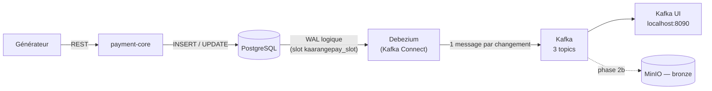
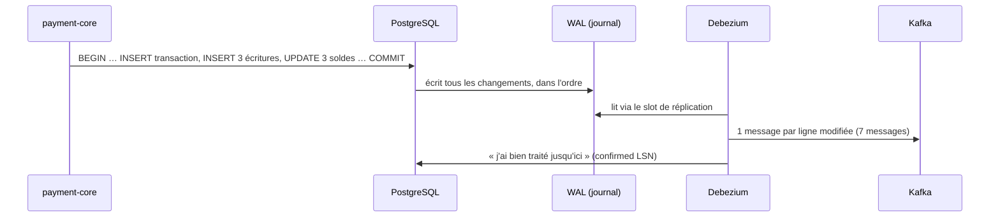
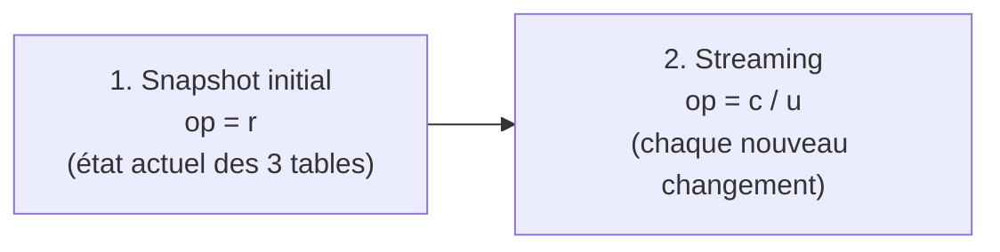

# KaaranguéPay — Guide de la phase 2a : capturer chaque changement (CDC)

> Objectif : chaque modification dans PostgreSQL devient **un message Kafka**, dans l'ordre,
> sans en perdre un, **sans toucher au code de payment-core**.

---

## 1. Vue d'ensemble



| Service | Rôle | Port sur ton PC |
|---|---|---|
| `kafka` | Le « journal » distribué qui stocke les messages | 9094 |
| `connect` | Kafka Connect + Debezium : lit le WAL de PostgreSQL et publie dans Kafka | 8083 |
| `connect-init` | Petit job qui enregistre le connecteur puis s'arrête | — |
| `kafka-ui` | Interface web pour voir les topics et les messages | **8090** |

Tous ces services sont dans le **profil `cdc`** : ils ne démarrent que si on le demande. La phase 1 reste légère.

---

## 2. Le WAL : pourquoi Debezium n'a pas besoin de toucher au code

Avant d'écrire une ligne dans ses tables, PostgreSQL l'écrit dans son **WAL** (*Write-Ahead Log*).
C'est ce qui lui permet de récupérer après un crash. En mode `wal_level=logical`, réglé dès la
phase 1, ce journal est **lisible de l'extérieur**.



**Seuls les changements COMMIT sont publiés.** Une transaction annulée (rollback) n'apparaît
jamais dans Kafka : on a exactement l'état validé de la base.

### Pourquoi pas les autres méthodes ? (ADR 0006)

| Méthode | Problème |
|---|---|
| Interroger la base toutes les X secondes | Rate des mises à jour, charge la base |
| Le service écrit dans PostgreSQL **et** dans Kafka | Un crash entre les deux écritures = un événement perdu ou en double |
| **CDC par le journal (Debezium)** ✅ | Tout ce qui est validé, dans l'ordre, sans modifier le service |

---

## 3. Les topics

| Topic | Contient | Particularité |
|---|---|---|
| `kaarangepay.public.transactions` | 1 message par transaction | Table en **insertion seule** |
| `kaarangepay.public.ledger_entries` | 1 message par écriture comptable | Table en **insertion seule** |
| `kaarangepay.public.accounts` | 1 message par création **et par mise à jour** de compte | Beaucoup de messages : le solde change à chaque paiement |

**Clé du message = clé primaire de la ligne.** Kafka envoie toujours la même clé vers la même
partition, donc **tous les changements d'un même compte arrivent dans l'ordre**. C'est essentiel
pour reconstruire un solde.

---

## 4. Anatomie d'un message Debezium

Exemple pour une nouvelle transaction (simplifié) :

```json
{
  "before": null,
  "after": {
    "id": "5f0c…",
    "transaction_type": "PAYMENT",
    "status": "COMPLETED",
    "amount": 3500,
    "fee": 0,
    "occurred_at": "2026-11-25T12:41:07Z",
    "recorded_at": "2026-11-18T16:52:10.123Z"
  },
  "source": { "connector": "postgresql", "table": "transactions", "lsn": 24023128, "txId": 1532 },
  "op": "c",
  "ts_ms": 1795020730456
}
```

| Champ | Sens |
|---|---|
| `before` / `after` | La ligne avant et après le changement |
| `op` | `r` = lecture du snapshot initial, `c` = création, `u` = mise à jour, `d` = suppression |
| `source.lsn` | Position exacte dans le WAL : permet de reprendre au bon endroit après une panne |
| `source.txId` | Identifiant de la transaction PostgreSQL : les 7 messages d'un même paiement ont le même |
| `ts_ms` | Quand Debezium a traité le changement : un **troisième temps**, après `occurred_at` et `recorded_at` |

> Pour un compte, un message `u` contient le solde **avant** et **après** : on voit l'argent bouger.

---

## 5. Snapshot puis streaming



Ta base contient déjà le mois de novembre (~134 000 transactions). Au premier démarrage, Debezium
**photographie** d'abord tout le contenu actuel (`op = r`), puis bascule sur le flux en direct.

⚠️ Le snapshot ne contient que **l'état actuel** des comptes, pas l'historique de leurs soldes.
L'historique complet existe dans `ledger_entries` (chaque ligne a son `balance_after`).

---

## 6. Démarrer (Windows)

### 6.1 Télécharger les images d'abord (~1,3 Go, à faire avec une bonne connexion)
Une par une : si l'une coupe, relance-la, Docker reprend où il en était.
```bat
docker pull apache/kafka:3.9.1
docker pull quay.io/debezium/connect:3.0
docker pull ghcr.io/kafbat/kafka-ui:latest
docker pull curlimages/curl:8.11.1
```

### 6.2 Lancer
```bat
cd C:\mobile-money-data-platform
docker compose up -d postgres payment-core
docker compose --profile cdc up -d
```
Attends environ 1 minute, puis vérifie que `connect-init` s'est terminé avec le code 0 :
```bat
docker compose --profile cdc ps -a
```

### 6.3 Vérifier
**Statut du connecteur** (on attend `"state":"RUNNING"` deux fois) :
```bat
curl http://localhost:8083/connectors/kaarangepay-postgres/status
```

**Les topics existent :**
```bat
docker compose exec kafka /opt/kafka/bin/kafka-topics.sh --bootstrap-server kafka:9092 --list
```

**Lire un message :**
```bat
docker compose exec kafka /opt/kafka/bin/kafka-console-consumer.sh --bootstrap-server kafka:9092 --topic kaarangepay.public.transactions --from-beginning --max-messages 1
```

**Ou tout voir dans le navigateur :** http://localhost:8090

---

## 7. La réconciliation : prouver qu'aucun message ne manque

Les tables `transactions` et `ledger_entries` sont en **insertion seule**.
Donc, une fois le snapshot terminé : **nombre de messages dans le topic = nombre de lignes dans la table.**

**Lignes en base :**
```bat
docker compose exec postgres psql -U mmplatform -d mmplatform -c "SELECT (SELECT COUNT(*) FROM transactions) AS transactions, (SELECT COUNT(*) FROM ledger_entries) AS ledger_entries;"
```

**Messages dans Kafka** (une ligne par partition `topic:partition:offset` ; additionne les 3 offsets) :
```bat
docker compose exec kafka /opt/kafka/bin/kafka-get-offsets.sh --bootstrap-server kafka:9092 --topic kaarangepay.public.transactions
```

Si les deux nombres sont égaux, **le CDC n'a rien perdu ni dupliqué**. C'est la même logique de
réconciliation que l'invariant du ledger, appliquée au pipeline.

> Fais-le une fois **sans** trafic (les chiffres doivent être identiques), puis lance le générateur
> en mode `live` et regarde les messages arriver dans Kafka UI.

---

## 8. Le piège du slot de réplication ⚠️

Le slot dit à PostgreSQL : « garde le WAL tant que Debezium ne l'a pas lu ».
**Si Debezium est arrêté longtemps pendant que la base reçoit du trafic, le WAL s'accumule sur le disque.**

**Surveiller le retard du slot :**
```bat
docker compose exec postgres psql -U mmplatform -d mmplatform -c "SELECT slot_name, active, pg_size_pretty(pg_wal_lsn_diff(pg_current_wal_lsn(), confirmed_flush_lsn)) AS retard FROM pg_replication_slots;"
```

**Arrêter le CDC proprement pour longtemps :**
```bat
curl -X DELETE http://localhost:8083/connectors/kaarangepay-postgres
docker compose exec postgres psql -U mmplatform -d mmplatform -c "SELECT pg_drop_replication_slot('kaarangepay_slot');"
docker compose --profile cdc stop
```

C'est une vraie question d'entretien : *« Que se passe-t-il si votre connecteur CDC tombe ? »*

---

## 9. Questions d'entretien

| Question | Réponse courte |
|---|---|
| Pourquoi le CDC plutôt qu'écrire dans Kafka depuis le service ? | Pas de transaction commune entre PostgreSQL et Kafka : un crash entre les deux perd ou duplique. Le WAL ne contient que ce qui est validé, dans l'ordre. |
| Comment garantissez-vous l'ordre ? | Clé du message = clé primaire, donc même partition pour une même ligne. L'ordre est garanti par partition. |
| Que se passe-t-il si Debezium redémarre ? | Il reprend à la dernière position confirmée (LSN), stockée dans Kafka. Il peut rejouer quelques messages : les consommateurs doivent être idempotents. |
| Comment savez-vous que rien n'est perdu ? | Réconciliation : messages = lignes pour les tables en insertion seule. |
| Un risque en production ? | Le slot retient le WAL si le connecteur tombe : surveillance du retard et alerte. |

---

## 10. Glossaire

| Terme | Définition simple |
|---|---|
| CDC | *Change Data Capture* : capter chaque modification d'une base |
| WAL | Le journal où PostgreSQL écrit chaque changement avant de l'appliquer |
| LSN | *Log Sequence Number* : une position dans le WAL |
| Slot de réplication | Un marque-page côté PostgreSQL : jusqu'où Debezium a lu |
| Publication | La liste des tables que PostgreSQL accepte de diffuser |
| Topic | Une file de messages dans Kafka (ici : une par table) |
| Partition | Une sous-file d'un topic : l'ordre est garanti à l'intérieur d'une partition |
| Offset | La position d'un message dans une partition |
| KRaft | Mode de Kafka sans ZooKeeper : Kafka gère lui-même son cluster |
| Kafka Connect | Le cadre qui fait tourner des connecteurs (ici Debezium) |
