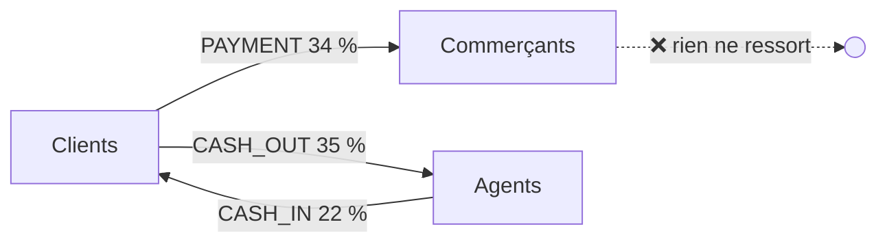
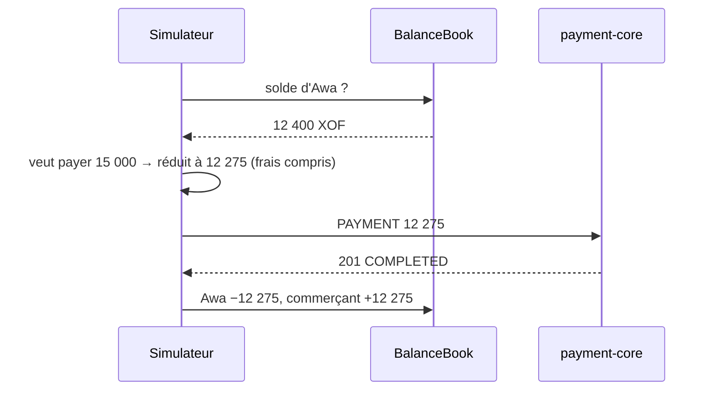

# KaaranguéPay — Journal de bord

> Chaque problème rencontré, sa cause, la correction et **ce qu'il faut en retenir**.
> En entretien, ces histoires vraies valent plus qu'un projet « qui marche du premier coup ».

---

## Session 1 — 18 novembre 2026 : premier lancement de la phase 1

**Environnement :** Windows 10, Docker Desktop, connexion internet lente et instable.

### Résumé

| # | Problème | Gravité | Cause | Statut |
|---|---|---|---|---|
| 1 | Build Docker interrompu | Environnement | Téléchargement coupé (connexion) | ✅ Résolu |
| 2 | Port 8080 déjà pris | Environnement | Conteneur Nagios existant | ✅ Résolu |
| 3 | `UnknownHostException: postgres` | Environnement | Réseau Docker incohérent après un échec | ✅ Résolu |
| 4 | `unrecognized arguments: --rate` | Bug (doc) | Ordre des options CLI | ✅ Corrigé |
| 5 | Logs illisibles pendant le backfill | Confort | `httpx` logue chaque requête | ✅ Corrigé |
| 6 | **Taux d'échec de 16 à 31 %** | **Bug de modélisation** | L'argent fuit hors des clients | ✅ Corrigé en v1.1 (session 3) |
| 7 | Tests d'intégration : `Could not find a valid Docker environment` | Dépendance | Testcontainers 1.21.3 incompatible avec Docker 29 | ✅ Corrigé (26/26 tests verts) |
| 8 | Mode `live` : 422 à l'ouverture des comptes | Bug générateur | Même graine = mêmes numéros de téléphone | ✅ Corrigé (session 4) |

Bilan : **le code Java a démarré du premier coup** (Flyway, validation Hibernate, ledger).
Tous les blocages venaient de l'environnement, de la documentation ou du générateur.

---

### 1. Build Docker interrompu

**Symptôme**
```
failed to compute cache key: short read: expected 158122724 bytes but got 128860782: unexpected EOF
```

**Cause :** l'image `maven:3.9-eclipse-temurin-21` (158 Mo) a été coupée pendant le téléchargement, à 128 Mo.
Ce n'était pas une erreur de code.

**Correction**
```bat
docker builder prune -f
docker pull maven:3.9-eclipse-temurin-21
docker compose up -d --build postgres payment-core
```
`docker pull` seul est plus fiable que le pull fait pendant un build, et il reprend les couches déjà téléchargées.

**À retenir**
- Il faut **lire le message d'erreur jusqu'au bout** : « short read … EOF » parle d'un téléchargement, pas du code.
- Un Dockerfile *multi-stage* télécharge une image de build (Maven) et une image d'exécution (JRE).
  Seule l'image JRE, plus légère, part en production.

---

### 2. Port 8080 déjà utilisé

**Symptôme**
```
Bind for 0.0.0.0:8080 failed: port is already allocated
```

**Diagnostic**
```bat
docker ps          → nagios  0.0.0.0:8080->80/tcp
```

**Correction :** Nagios n'était plus utile.
```bat
docker stop nagios
docker update --restart=no nagios
```

**À retenir**
- `"8080:8080"` dans docker-compose veut dire « port 8080 **de mon PC** vers le port 8080 **du conteneur** ».
  Deux conteneurs ne peuvent pas prendre le même port côté PC.
- Ports déjà occupés sur ma machine, à éviter pour les phases suivantes :
  `3000` (Grafana), `8025` (MailHog), `8081` (cAdvisor), `9090` (Prometheus), `9100` (node-exporter).
- Amélioration faite : le port est maintenant configurable avec `APP_PORT` (voir docker-compose).

---

### 3. `UnknownHostException: postgres`

**Symptôme** (dans `docker compose logs payment-core`)
```
Caused by: java.net.UnknownHostException: postgres
```

**Méthode de lecture d'une stack trace Java :** on descend jusqu'au **dernier `Caused by:`**.
C'est la cause racine ; tout ce qui est au-dessus n'en est que la conséquence.
```
BeanCreationException (entityManagerFactory)
 └─ Caused by: flywayInitializer
     └─ Caused by: FlywaySqlException: Unable to obtain connection
         └─ Caused by: PSQLException: The connection attempt failed
             └─ Caused by: UnknownHostException: postgres   ← la vraie cause
```

**Cause :** dans un réseau Docker Compose, chaque service est joignable par son nom (`postgres`) grâce au DNS interne.
Le conteneur `payment-core` avait été créé pendant l'échec du port 8080 et n'était pas correctement branché au réseau.

**Correction**
```bat
docker compose down        (supprime conteneurs + réseau, GARDE les données)
docker compose up -d postgres payment-core
```

**À retenir**
- `docker compose down` remet à plat. `down -v` supprime **aussi** les volumes, donc les données.
- Amélioration faite : `restart: on-failure` sur payment-core. Si la base n'est pas joignable au démarrage,
  Docker relance l'application au lieu de la laisser arrêtée.

**Résultat après correction**
```json
{"sumOfBalances":0,"unbalancedTransactions":0,"accountsWithDrift":0,"healthy":true}
```
Cela prouve que Spring Boot démarre, que Flyway a créé les tables et que les entités Java correspondent au schéma.

---

### 4. `unrecognized arguments: --rate 300`

**Cause (erreur dans ma documentation) :** le CLI a deux niveaux d'options.
```
mmgen [options générales] backfill [options de backfill]
       --base-url, --rate          --start, --days, --workers
```
Une option générale placée après `backfill` est refusée par `argparse`.

**Commande correcte**
```bat
docker compose --profile traffic run --rm traffic-generator ^
  --base-url http://payment-core:8080 --rate 300 backfill --start 2026-11-01 --days 30
```
Le Makefile est corrigé.

---

### 5. Logs illisibles pendant le backfill

`httpx` affichait chaque requête HTTP en `INFO`, ce qui faisait des dizaines de milliers de lignes.
**Correction :** le logger `httpx` passe en `WARNING`. On ne voit plus que la progression et le résumé final.

**Lecture des codes HTTP pendant le backfill :**

| Code | Signification |
|---|---|
| `201` | Transaction réussie |
| `422` | Refusée (fonds insuffisants, compte bloqué), **mais enregistrée** en `FAILED` |
| `200` | **Replay idempotent** : même clé renvoyée, ancien résultat rendu, **pas de second débit** |

---

### 6. Taux d'échec irréalistes (le plus intéressant)

**Débit observé :** ~40 000 transactions en ~2 minutes (≈ 300 tx/s) sur un PC portable.

#### Ce qui est réaliste ✅

**Activité par heure** (`occurred_at`, au moment de l'analyse) :
```
heure  0 |  704  ← artefact (voir plus bas)
heure  3 |   71  ← creux de la nuit
heure  8 | 2373  ← montée du matin
heure 12 | 3608  ← pic de midi
heure 18 | 3633  ← pic du soir
heure 23 |  367
```

**Activité par jour :** jours 1 à 3 au-dessus de 5 400 (période de paie), ~3 700 ensuite,
dimanche 8 novembre plus calme (2 921).

**Artefact à minuit :** les ~515 opérations d'initialisation (float des agents et premier dépôt de chaque client)
sont toutes datées du 1er novembre à 00:00. À étaler sur la première journée.

#### Ce qui ne l'est pas ❌

| Type | % d'échec observé | Valeur réaliste |
|---|---|---|
| CASH_OUT | 31,5 % | 1 à 5 % |
| TRANSFER | 29,7 % | 1 à 5 % |
| PAYMENT | 16,5 % | 1 à 5 % |
| CASH_IN | 0,1 % | ✅ |

#### Diagnostic : l'argent fuit hors des clients



1. **Les sorties dépassent largement les entrées** : 69 % des transactions font sortir de l'argent des clients,
   contre 22 % qui en font entrer, avec des montants médians comparables. Les clients se vident en quelques jours.
2. **Les commerçants accumulent sans jamais reverser.** Leur argent sort du circuit.
3. **Le générateur tire un montant sans regarder le solde**, alors qu'un vrai client voit son solde avant de payer.

**Important :** le système, lui, est juste. Les transactions sont correctement refusées et le ledger reste à
`healthy`. C'est le **comportement simulé** qui est faux.

#### Corrections prévues (v1.1)

| Correction | Effet attendu |
|---|---|
| Salaires en période de paie (gros CASH_IN) | L'argent revient chez les clients |
| Les commerçants reversent leurs recettes (retrait marchand) | L'argent recircule |
| Les clients dépensent selon leur solde, avec ~3 % de tentatives au-dessus | Échecs rares mais présents |
| Opérations d'initialisation étalées sur le premier jour | Plus de pic à minuit |
| **Test automatique : taux d'échec entre 2 et 5 %** | Le problème ne peut plus revenir sans être vu |

#### À retenir — c'est le cœur du métier de data engineer
1. **Charger** les données.
2. **Profiler** : distributions par heure, par jour, taux d'échec.
3. **Repérer l'anomalie** : 31 % d'échec n'a aucun sens métier.
4. **Remonter à la cause** : le modèle de flux, pas le système.
5. **Corriger et ajouter un test** pour que ça ne revienne pas.

**Formulation pour un entretien :**
> « En profilant les premières données, j'ai vu 30 % de transactions refusées, alors qu'un opérateur réel
> en a moins de 5 %. Le ledger était correct, c'était la simulation : l'argent sortait des clients plus
> vite qu'il n'entrait, et les commerçants ne reversaient jamais leurs recettes. J'ai rééquilibré les flux
> et ajouté un test qui vérifie le taux d'échec. »

---

### Résultats définitifs du backfill (30 jours, novembre 2026)

| Indicateur | Valeur |
|---|---|
| Durée | 654 s (~11 min) |
| Appels API | 134 335 |
| Débit moyen | **205 tx/s** (PC portable, Docker Desktop) |
| Replays idempotents | 1 329 (~1 %, conforme à `--duplicate-rate 0.01`) |
| Fraudes « account takeover » | 224 (~0,17 % ; les victimes presque vides sont sautées) |
| Recharges d'agents | 39 |

| Type | Réussies | Échouées | % échec |
|---|---|---|---|
| CASH_IN | 29 475 | 39 | 0,1 % ✅ |
| PAYMENT | 38 568 | 7 212 | 15,8 % ❌ |
| TRANSFER | 8 587 | 3 537 | 29,2 % ❌ |
| CASH_OUT | 32 357 | 14 560 | 31,0 % ❌ |

**Cohérence :** 39 CASH_IN échoués = 39 recharges d'agents. Chaque agent à court de float a fait échouer
un CASH_IN, a été rechargé, puis le CASH_IN a été relancé.

#### Le ledger tient après 134 000 opérations concurrentes ✅
```json
{"sumOfBalances":0,"unbalancedTransactions":0,"accountsWithDrift":0,"healthy":true}
```

#### Où est l'argent ? Le diagnostic est confirmé ✅

| Type de compte | Comptes | Solde total (XOF) | Part |
|---|---|---|---|
| MERCHANT | 40 | 187 238 525 | **70 %** |
| AGENT | 15 | 43 565 969 | 16 % |
| CUSTOMER | 500 | 35 739 810 | **13 %** |
| SYSTEM | 2 | −266 544 304 | (contrepartie) |

**Vérification à la main de l'invariant :**
43 565 969 + 35 739 810 + 187 238 525 = **266 544 304** et 266 544 304 − 266 544 304 = **0** ✅

**Ce qu'on peut déduire sans requête supplémentaire :**
- Monnaie émise par le TREASURY : (15 agents au départ + 39 recharges) × 5 000 000 = **270 000 000 XOF**,
  donc TREASURY = −270 000 000.
- SYSTEM = TREASURY + FEES = −266 544 304, donc **FEES = 3 455 696 XOF** de frais encaissés en un mois.
- **40 commerçants détiennent 70 % de l'argent**, contre 13 % pour 500 clients.
  C'est la preuve chiffrée de la fuite : l'argent entre chez les commerçants et n'en ressort jamais.

> Le système est juste (invariants à 0), la simulation est déséquilibrée. Correction en v1.1.

---

### 7. `mvn verify` : les tests d'intégration ne trouvent pas Docker

**Contexte :** ni Java ni Maven n'étaient installés sur le PC. Les tests ont donc été lancés **dans le conteneur Maven**,
avec le socket Docker monté pour que Testcontainers puisse lancer un PostgreSQL de test :
```bat
docker run --rm -v "%cd%:/app" -w /app -v m2cache:/root/.m2 -v /var/run/docker.sock:/var/run/docker.sock ^
  -e TESTCONTAINERS_HOST_OVERRIDE=host.docker.internal maven:3.9-eclipse-temurin-21 mvn -B verify
```

**Résultat :** **le code compile et les 15 tests unitaires passent** (frais, routage, hash, horloge).
Les 2 classes de tests d'intégration échouent avant même de démarrer :
```
UnixSocketClientProviderStrategy: failed with exception BadRequestException (Status 400 ...)
IllegalStateException: Could not find a valid Docker environment
```

**Cause :** Docker Engine 29 a relevé la version minimale de l'API Docker à 1.44.
Testcontainers 1.21.3 (la version fournie par Spring Boot 3.5.7) demande l'API 1.32, et le démon répond `400`.
Le socket était bien accessible : le démon a répondu, il a seulement refusé la version demandée.
Ce problème a touché énormément de projets Java fin 2025.

**Confirmation :** `docker version` affiche `API version: 1.56 (minimum version 1.40)`.
Testcontainers 1.21.3 demandait 1.32, en dessous du minimum, d'où le refus.

**Correction :** forcer Testcontainers **1.21.4**, qui utilise une API compatible, dans `pom.xml` :
```xml
<testcontainers.version>1.21.4</testcontainers.version>
```
Spring Boot gère les versions des dépendances via des *properties* : il suffit de surcharger celle-ci.

**À retenir**
- Les tests unitaires (sans Docker) et les tests d'intégration (avec Docker) échouent pour des raisons différentes.
  Ici, la logique métier était validée ; seul l'outillage était cassé.
- Une mise à jour d'infrastructure (Docker 29) peut casser un projet sans qu'une ligne de code change.
  C'est pour ça qu'on fige et qu'on documente les versions.

---

---

## Session 2 — 18 novembre 2026 (midi) : tous les tests passent ✅

**Piège au redémarrage :** `request returned 500 Internal Server Error ... dockerDesktopLinuxEngine/_ping`.
Docker Desktop n'était pas encore démarré après le redémarrage du PC.
Réflexe : `docker version` doit afficher **deux** blocs, `Client:` **et** `Server:`.

**Résultat de `mvn verify` (dans le conteneur Maven, Testcontainers 1.21.4) :**

| Classe de test | Tests | Durée | Ce qui est prouvé |
|---|---|---|---|
| `FeePolicyTest` | 9 | 0,3 s | Frais en entiers, arrondi en faveur du client, plafond |
| `TransactionRulesTest` | 6 | 0,03 s | Routage, hash d'idempotence, horloge simulée |
| `PaymentApiIntegrationTest` | 9 | 3 s | API de bout en bout sur un vrai PostgreSQL |
| `LedgerConcurrencyIntegrationTest` | 2 | 130 s | 4 000 transferts concurrents + exactly-once sous retries |
| **Total** | **26** | | **BUILD SUCCESS** |

### Les 9 lignes `ERROR: duplicate key ... idempotency_key` sont la preuve que ça marche

Pendant le test `concurrentRetriesOfTheSameRequestExecuteExactlyOnce`, PostgreSQL a affiché :
```
ERROR: duplicate key value violates unique constraint "transactions_idempotency_key_key"   (× 9)
```
Ce ne sont **pas** des erreurs du programme. Le test envoie **10 requêtes identiques en même temps**, avec la même clé :
1. une seule passe et exécute le paiement ;
2. les **9 autres** se heurtent à la contrainte `UNIQUE` de la base, d'où les 9 lignes ;
3. `TransactionFacade` attrape chaque erreur et **rejoue** le résultat de la première (ADR 0003).

10 tentatives − 1 exécution = **9 doublons bloqués**, et le test vérifie que le compte n'a été crédité qu'une fois.
**C'est la base de données qui garantit l'exactly-once**, pas un simple `if` dans le code Java.

> À améliorer (v1.1) : baisser le niveau de log de `SqlExceptionHelper` pour ce cas attendu,
> afin qu'un vrai problème ne se noie pas dans ces lignes.

**Les autres avertissements** (Mockito *self-attaching*, *Dynamic loading of agents*) sont normaux sous Java 21
et ne concernent que l'outillage de test.

### Bilan de la phase 1

| Élément | Statut |
|---|---|
| Démarrage, Flyway, validation du schéma | ✅ |
| 134 335 opérations concurrentes, ledger à 0 | ✅ |
| Idempotence (1 329 replays en charge, exactly-once prouvé en test) | ✅ |
| 26 tests automatisés (unitaires + Testcontainers) | ✅ |
| Motifs réalistes jour/nuit, paie, dimanche | ✅ |
| Équilibre des flux d'argent dans le générateur | ✅ v1.1 (session 3) |

---

---

## Session 3 — 18 novembre 2026 (après-midi) : v1.1, l'argent circule enfin

**Objectif :** corriger le problème n°6 (16 à 31 % d'échecs, 70 % de l'argent bloqué chez les commerçants).

### Les 4 causes et leurs corrections

| Cause (session 1) | Correction v1.1 | Où |
|---|---|---|
| Les commerçants accumulent sans jamais reverser | `CASH_OUT` autorisé depuis un compte **MERCHANT** ; ~3 % des événements sont des retraits de recettes | Java + générateur |
| Les entrées (22 %) < les sorties (69 %) | **Salaires** en période de paie ; un client à sec va faire un `CASH_IN` au lieu d'échouer | Générateur |
| Montant tiré sans regarder le solde | `BalanceBook` : le générateur suit les soldes et dépense **dans les moyens**, sauf **3 %** de tentatives volontairement au-dessus | Générateur |
| ~515 opérations à 00:00 le jour 1 | Onboarding daté de **la veille** (agents 06h-07h, clients 08h-21h) | Générateur |

### Le carnet de soldes (`BalanceBook`)



**Pourquoi ce n'est pas tricher :** un vrai client voit son solde dans l'appli avant de payer.
Le carnet n'est qu'une **estimation** : la vérité reste le ledger du serveur. Sous concurrence,
l'estimation peut avoir un léger retard, ce qui ajoute quelques refus réalistes.

**Calcul du montant maximal payable :** frais compris, on cherche le plus grand montant `m` tel que
`m + frais(m) ≤ solde`. Les frais étant arrondis à l'inférieur et plafonnés, il n'y a pas de formule
simple : on fait une **recherche dichotomique**, ce qui est possible car `m + frais(m)` croît avec `m`.

### Résultats en simulation (40 000 événements, faux serveur avec les mêmes règles)

| Indicateur | v1.0 (réel) | v1.1 (simulation) |
|---|---|---|
| Taux d'échec global | ~19 % | **2,2 %** |
| PAYMENT / CASH_OUT / TRANSFER | 15,8 % / 31,0 % / 29,2 % | **3,2 % / 2,8 % / 3,1 %** |
| Part de l'argent chez les clients | 13 % | **77 %** |
| Part chez les commerçants | 70 % | **1 %** |

> ⚠️ Ce sont des chiffres de **simulation contre le faux serveur**. Il faut les confirmer avec un vrai
> backfill sur la plateforme (voir « À faire » ci-dessous).

**Nouveaux tests automatiques** (20 tests Python au total, plus 1 test Java d'API et 1 assertion de routage) :
- le taux d'échec doit rester **entre 1 % et 5 %** : le bug de la v1.0 ne peut plus revenir sans faire échouer la CI ;
- les commerçants doivent détenir **moins** que les clients ;
- l'onboarding doit être daté de la veille ;
- le montant « payable » doit être exactement le plus grand possible ;
- côté Java : un commerçant peut retirer ses recettes (frais de 0,5 % vérifiés).

### Validation sur la vraie plateforme ✅

**Tests Java : 27/27 verts** (le nouveau test `merchantCanWithdrawTakingsAtAnAgent` passe).

**Backfill de 30 jours sur une base neuve** (`docker compose down -v`, pour ne pas mélanger v1.0 et v1.1) :

| Indicateur | v1.0 (session 1) | v1.1 (réel) |
|---|---|---|
| Taux d'échec global | ~19 % | **2,3 %** (la simulation prévoyait 2,2 %) |
| CASH_OUT / PAYMENT / TRANSFER | 31,0 / 15,8 / 29,2 % | **3,4 / 3,1 / 3,3 %** |
| CASH_IN | 0,1 % | 0,02 % |
| Durée / débit | 654 s / 205 appels/s | **408 s / 328 appels/s** |
| Replays idempotents | 1 329 | 1 269 |
| Fraudes | 224 | 246 |
| Salaires / retraits marchands / dépassements volontaires | — | 6 148 / 4 060 / 2 699 |
| Ledger | `healthy` | `healthy` ✅ |

**Le débit a augmenté de 60 % sans toucher au serveur.** Une tentative refusée coûte presque autant
qu'une réussie (verrous, vérifications, écriture `FAILED`). Moins de refus inutiles = plus de capacité utile.

**Répartition de l'argent :**

| Type | Solde total (XOF) | Part |
|---|---|---|
| CUSTOMER (500) | 351 563 903 | **88 %** (13 % en v1.0) |
| AGENT (15) | 45 618 578 | 11 % |
| MERCHANT (40) | 1 187 286 | **0,3 %** (70 % en v1.0) |
| SYSTEM | −398 369 767 | contrepartie |

Invariant vérifié à la main : 45 618 578 + 351 563 903 + 1 187 286 = 398 369 767 → somme = **0** ✅.
Frais encaissés : TREASURY = −(15 + 66 recharges) × 5 000 000 = −405 000 000, donc
**FEES = 405 000 000 − 398 369 767 = 6 630 233 XOF**.

### Le coût caché des builds Docker

La reconstruction de `payment-core` a pris **9 minutes**, dont presque toutes pour retélécharger
~150 Mo de dépendances Maven. La raison : on avait modifié `pom.xml` (Testcontainers 1.21.4), et Docker
refait toutes les étapes qui suivent un fichier modifié. Le cache `m2cache` des tests n'est pas partagé
avec la construction d'image.

**Correction :** un *cache mount* BuildKit dans le Dockerfile :
```dockerfile
RUN --mount=type=cache,target=/root/.m2 mvn -q -B dependency:go-offline
```
Le dossier `~/.m2` survit maintenant entre deux builds : une modification de `pom.xml` ne retélécharge
plus que ce qui a changé. **Sur une connexion lente, c'est la différence entre 9 minutes et 30 secondes.**

### Ce qui reste perfectible (v1.2, honnêtement)

La fuite est corrigée, mais le profilage révèle deux excès **dans l'autre sens** :
1. **Les clients sont trop riches** : en moyenne ~703 000 XOF par portefeuille. Les salaires
   (6 148 dépôts, médiane 80 000 XOF) font entrer plus d'argent qu'il n'en sort. Pour un portefeuille
   mobile au Sénégal, c'est irréaliste.
2. **Les commerçants ne gardent presque rien** (0,3 %) : ils retirent 60 à 90 % de leurs recettes dès
   qu'ils dépassent 20 000 XOF. Un vrai commerçant garde un fonds de roulement.

Pistes : moins de salaires (ou des clients qui retirent une partie de leur salaire en cash),
et des commerçants qui gardent un solde minimum. **Leçon :** corriger un déséquilibre peut en créer un
autre. On mesure, on corrige, on remesure.

**À retenir :** une correction n'est pas finie quand le code compile. Elle est finie quand un
**test empêche le problème de revenir** et qu'une **mesure réelle** confirme l'effet.

---

---

## Session 4 — 18 novembre 2026 (soir) : phase 2a, le CDC fonctionne ✅

**Objectif :** que chaque changement validé dans PostgreSQL devienne un message Kafka (ADR 0006,
guide `docs/GUIDE-PHASE2-FR.md`).

### Préparation
- **Ressources :** Docker dispose de 7,6 Go de RAM et 8 CPU (`docker info`). Sous WSL 2, Docker Desktop
  n'affiche pas de réglage mémoire : il faut le demander à `docker info`.
- **Téléchargements :** ~1,14 Go au total (Debezium 702 Mo, Kafka UI 225 Mo, Kafka 204 Mo, curl 10 Mo),
  faits image par image pour pouvoir reprendre en cas de coupure.
- **Piège Windows :** coller deux blocs de commandes d'un coup peut les fusionner sur une ligne
  (`payment-coredocker compose …`). Un bloc à la fois, ou `&&` entre les commandes.

### Démarrage
| Service | Prêt en |
|---|---|
| Kafka (KRaft) | 13 s |
| Debezium Connect | 34 s |
| `connect-init` | `Exited (0)` |
| Statut du connecteur | `RUNNING` (connecteur + tâche) |

`connect-init` a été lancé deux fois par erreur : sans conséquence, car `PUT /connectors/{name}/config`
est **idempotent**. C'est le même principe que les clés d'idempotence de la phase 1, appliqué à l'infra.

### Snapshot initial
`Snapshot ended with SnapshotResult [status=COMPLETED … lsn=LSN{0/1688A970}, txId=134642]` en **~18 s**.
Le **LSN** est le point de jonction : le streaming reprend exactement là où la photo a été prise.

### Réconciliation (messages Kafka = lignes PostgreSQL)

| Table | Après le snapshot | Après 3 min de trafic live | Écart |
|---|---|---|---|
| `transactions` | 133 316 = 133 316 | **133 845 = 133 845** | **0** |
| `ledger_entries` | 308 608 = 308 608 | **309 668 = 309 668** | **0** |

**442 000+ lignes capturées sans perte ni doublon.** Les 3 partitions de chaque topic sont équilibrées
(~33 % chacune) : la clé primaire se répartit uniformément par hachage. On retrouve aussi
~2,3 écritures par transaction (2 sans frais, 3 avec frais, 0 si refusée).

### Lire Kafka UI : 8 topics, 93 partitions

| Topics | Partitions | Rôle |
|---|---|---|
| `kaarangepay.public.{transactions,ledger_entries,accounts}` | 9 | Les données |
| `__debezium-heartbeat.kaarangepay` | 3 | Battement de cœur toutes les 10 s : fait avancer le slot même sans changement |
| `_connect_configs` / `_connect_offsets` / `_connect_statuses` | 1 + 25 + 5 | Mémoire de Kafka Connect, dont **la position dans le WAL** |
| `__consumer_offsets` | 50 | Positions des lecteurs Kafka |

### Bug trouvé : le mode `live` refusait d'ouvrir des comptes (422)

**Symptôme :** `httpx.HTTPStatusError: Client error '422' for url …/api/v1/accounts` dès le premier compte.

**Cause :** le générateur utilise une graine fixe (`--seed 42`) pour être reproductible. Lancé après le
backfill, il a tiré **les mêmes numéros de téléphone**, et payment-core a refusé les doublons grâce à la
contrainte `UNIQUE` sur `phone`. **Le serveur avait raison**, c'est le générateur qui supposait une base vide.

**Pourquoi les tests ne l'avaient pas vu :** le faux serveur des tests ne vérifiait pas l'unicité des
téléphones, et chaque test partait d'une base vide.

**Correction :**
- `client.py` : un 422 « already exists » devient une erreur explicite `PhoneAlreadyUsedError` ;
- `simulator.py` : un numéro pris est remplacé par un autre, comme le ferait un opérateur ;
- `fake_api.py` : le faux serveur applique **la même contrainte UNIQUE** que le vrai ;
- 2 tests : deux runs successifs sur la même base, et la reconnaissance de l'erreur côté client.

**À retenir :** un faux serveur de test doit appliquer **les mêmes contraintes** que le vrai,
sinon il cache des bugs au lieu de les révéler.

---

### Requêtes SQL utiles (pour explorer soi-même)

```sql
-- Volume total
SELECT COUNT(*) FROM transactions;

-- Activité par heure (event time)
SELECT EXTRACT(HOUR FROM occurred_at) AS heure, COUNT(*) FROM transactions GROUP BY 1 ORDER BY 1;

-- Activité par jour du mois
SELECT EXTRACT(DAY FROM occurred_at) AS jour, COUNT(*) FROM transactions GROUP BY 1 ORDER BY 1;

-- Taux d'échec par type
SELECT transaction_type,
       ROUND(100.0 * COUNT(*) FILTER (WHERE status = 'FAILED') / COUNT(*), 1) AS pct_echec
FROM transactions GROUP BY 1;

-- Où est l'argent ? (solde total par type de compte)
SELECT account_type, COUNT(*) AS comptes, SUM(balance) AS solde_total
FROM accounts GROUP BY 1 ORDER BY 1;
```

À lancer avec :
```bat
docker compose exec postgres psql -U mmplatform -d mmplatform -c "<requête>"
```

La dernière requête **prouve le diagnostic** : on doit y voir les commerçants et les agents riches,
et les clients presque à zéro.
