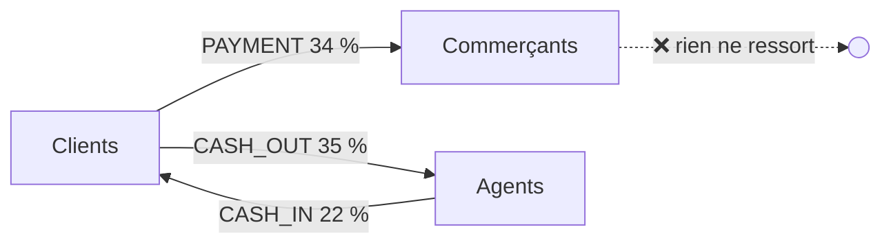

# KaaranguéPay — Journal de bord

> Chaque problème rencontré, sa cause, la correction et **ce qu'il faut en retenir**.
> En entretien, ces histoires vraies valent plus qu'un projet « qui marche du premier coup ».

---

## Session 1 — 18 novembre 2026 : premier lancement de la phase 1

**Environnement :** Windows 10, Docker Desktop, connexion internet lente et instable.

### Résumé

| # | Problème | Gravité | Cause | Statut |
|---|---|---|---|---|
| 1 | Build Docker interrompu | Environnement | Téléchargement coupé (connexion) | ✅ Résolu |
| 2 | Port 8080 déjà pris | Environnement | Conteneur Nagios existant | ✅ Résolu |
| 3 | `UnknownHostException: postgres` | Environnement | Réseau Docker incohérent après un échec | ✅ Résolu |
| 4 | `unrecognized arguments: --rate` | Bug (doc) | Ordre des options CLI | ✅ Corrigé |
| 5 | Logs illisibles pendant le backfill | Confort | `httpx` logue chaque requête | ✅ Corrigé |
| 6 | **Taux d'échec de 16 à 31 %** | **Bug de modélisation** | L'argent fuit hors des clients | ⏳ v1.1 |

Bilan : **le code Java a démarré du premier coup** (Flyway, validation Hibernate, ledger).
Tous les blocages venaient de l'environnement, de la documentation ou du générateur.

---

### 1. Build Docker interrompu

**Symptôme**
```
failed to compute cache key: short read: expected 158122724 bytes but got 128860782: unexpected EOF
```

**Cause :** l'image `maven:3.9-eclipse-temurin-21` (158 Mo) a été coupée pendant le téléchargement, à 128 Mo.
Ce n'était pas une erreur de code.

**Correction**
```bat
docker builder prune -f
docker pull maven:3.9-eclipse-temurin-21
docker compose up -d --build postgres payment-core
```
`docker pull` seul est plus fiable que le pull fait pendant un build, et il reprend les couches déjà téléchargées.

**À retenir**
- Il faut **lire le message d'erreur jusqu'au bout** : « short read … EOF » parle d'un téléchargement, pas du code.
- Un Dockerfile *multi-stage* télécharge une image de build (Maven) et une image d'exécution (JRE).
  Seule l'image JRE, plus légère, part en production.

---

### 2. Port 8080 déjà utilisé

**Symptôme**
```
Bind for 0.0.0.0:8080 failed: port is already allocated
```

**Diagnostic**
```bat
docker ps          → nagios  0.0.0.0:8080->80/tcp
```

**Correction :** Nagios n'était plus utile.
```bat
docker stop nagios
docker update --restart=no nagios
```

**À retenir**
- `"8080:8080"` dans docker-compose veut dire « port 8080 **de mon PC** vers le port 8080 **du conteneur** ».
  Deux conteneurs ne peuvent pas prendre le même port côté PC.
- Ports déjà occupés sur ma machine, à éviter pour les phases suivantes :
  `3000` (Grafana), `8025` (MailHog), `8081` (cAdvisor), `9090` (Prometheus), `9100` (node-exporter).
- Amélioration faite : le port est maintenant configurable avec `APP_PORT` (voir docker-compose).

---

### 3. `UnknownHostException: postgres`

**Symptôme** (dans `docker compose logs payment-core`)
```
Caused by: java.net.UnknownHostException: postgres
```

**Méthode de lecture d'une stack trace Java :** on descend jusqu'au **dernier `Caused by:`**.
C'est la cause racine ; tout ce qui est au-dessus n'en est que la conséquence.
```
BeanCreationException (entityManagerFactory)
 └─ Caused by: flywayInitializer
     └─ Caused by: FlywaySqlException: Unable to obtain connection
         └─ Caused by: PSQLException: The connection attempt failed
             └─ Caused by: UnknownHostException: postgres   ← la vraie cause
```

**Cause :** dans un réseau Docker Compose, chaque service est joignable par son nom (`postgres`) grâce au DNS interne.
Le conteneur `payment-core` avait été créé pendant l'échec du port 8080 et n'était pas correctement branché au réseau.

**Correction**
```bat
docker compose down        (supprime conteneurs + réseau, GARDE les données)
docker compose up -d postgres payment-core
```

**À retenir**
- `docker compose down` remet à plat. `down -v` supprime **aussi** les volumes, donc les données.
- Amélioration faite : `restart: on-failure` sur payment-core. Si la base n'est pas joignable au démarrage,
  Docker relance l'application au lieu de la laisser arrêtée.

**Résultat après correction**
```json
{"sumOfBalances":0,"unbalancedTransactions":0,"accountsWithDrift":0,"healthy":true}
```
Cela prouve que Spring Boot démarre, que Flyway a créé les tables et que les entités Java correspondent au schéma.

---

### 4. `unrecognized arguments: --rate 300`

**Cause (erreur dans ma documentation) :** le CLI a deux niveaux d'options.
```
mmgen [options générales] backfill [options de backfill]
       --base-url, --rate          --start, --days, --workers
```
Une option générale placée après `backfill` est refusée par `argparse`.

**Commande correcte**
```bat
docker compose --profile traffic run --rm traffic-generator ^
  --base-url http://payment-core:8080 --rate 300 backfill --start 2026-11-01 --days 30
```
Le Makefile est corrigé.

---

### 5. Logs illisibles pendant le backfill

`httpx` affichait chaque requête HTTP en `INFO`, ce qui faisait des dizaines de milliers de lignes.
**Correction :** le logger `httpx` passe en `WARNING`. On ne voit plus que la progression et le résumé final.

**Lecture des codes HTTP pendant le backfill :**

| Code | Signification |
|---|---|
| `201` | Transaction réussie |
| `422` | Refusée (fonds insuffisants, compte bloqué), **mais enregistrée** en `FAILED` |
| `200` | **Replay idempotent** : même clé renvoyée, ancien résultat rendu, **pas de second débit** |

---

### 6. Taux d'échec irréalistes (le plus intéressant)

**Débit observé :** ~40 000 transactions en ~2 minutes (≈ 300 tx/s) sur un PC portable.

#### Ce qui est réaliste ✅

**Activité par heure** (`occurred_at`, au moment de l'analyse) :
```
heure  0 |  704  ← artefact (voir plus bas)
heure  3 |   71  ← creux de la nuit
heure  8 | 2373  ← montée du matin
heure 12 | 3608  ← pic de midi
heure 18 | 3633  ← pic du soir
heure 23 |  367
```

**Activité par jour :** jours 1 à 3 au-dessus de 5 400 (période de paie), ~3 700 ensuite,
dimanche 8 novembre plus calme (2 921).

**Artefact à minuit :** les ~515 opérations d'initialisation (float des agents et premier dépôt de chaque client)
sont toutes datées du 1er novembre à 00:00. À étaler sur la première journée.

#### Ce qui ne l'est pas ❌

| Type | % d'échec observé | Valeur réaliste |
|---|---|---|
| CASH_OUT | 31,5 % | 1 à 5 % |
| TRANSFER | 29,7 % | 1 à 5 % |
| PAYMENT | 16,5 % | 1 à 5 % |
| CASH_IN | 0,1 % | ✅ |

#### Diagnostic : l'argent fuit hors des clients



1. **Les sorties dépassent largement les entrées** : 69 % des transactions font sortir de l'argent des clients,
   contre 22 % qui en font entrer, avec des montants médians comparables. Les clients se vident en quelques jours.
2. **Les commerçants accumulent sans jamais reverser.** Leur argent sort du circuit.
3. **Le générateur tire un montant sans regarder le solde**, alors qu'un vrai client voit son solde avant de payer.

**Important :** le système, lui, est juste. Les transactions sont correctement refusées et le ledger reste à
`healthy`. C'est le **comportement simulé** qui est faux.

#### Corrections prévues (v1.1)

| Correction | Effet attendu |
|---|---|
| Salaires en période de paie (gros CASH_IN) | L'argent revient chez les clients |
| Les commerçants reversent leurs recettes (retrait marchand) | L'argent recircule |
| Les clients dépensent selon leur solde, avec ~3 % de tentatives au-dessus | Échecs rares mais présents |
| Opérations d'initialisation étalées sur le premier jour | Plus de pic à minuit |
| **Test automatique : taux d'échec entre 2 et 5 %** | Le problème ne peut plus revenir sans être vu |

#### À retenir — c'est le cœur du métier de data engineer
1. **Charger** les données.
2. **Profiler** : distributions par heure, par jour, taux d'échec.
3. **Repérer l'anomalie** : 31 % d'échec n'a aucun sens métier.
4. **Remonter à la cause** : le modèle de flux, pas le système.
5. **Corriger et ajouter un test** pour que ça ne revienne pas.

**Formulation pour un entretien :**
> « En profilant les premières données, j'ai vu 30 % de transactions refusées, alors qu'un opérateur réel
> en a moins de 5 %. Le ledger était correct, c'était la simulation : l'argent sortait des clients plus
> vite qu'il n'entrait, et les commerçants ne reversaient jamais leurs recettes. J'ai rééquilibré les flux
> et ajouté un test qui vérifie le taux d'échec. »

---

### Requêtes SQL utiles (pour explorer soi-même)

```sql
-- Volume total
SELECT COUNT(*) FROM transactions;

-- Activité par heure (event time)
SELECT EXTRACT(HOUR FROM occurred_at) AS heure, COUNT(*) FROM transactions GROUP BY 1 ORDER BY 1;

-- Activité par jour du mois
SELECT EXTRACT(DAY FROM occurred_at) AS jour, COUNT(*) FROM transactions GROUP BY 1 ORDER BY 1;

-- Taux d'échec par type
SELECT transaction_type,
       ROUND(100.0 * COUNT(*) FILTER (WHERE status = 'FAILED') / COUNT(*), 1) AS pct_echec
FROM transactions GROUP BY 1;

-- Où est l'argent ? (solde total par type de compte)
SELECT account_type, COUNT(*) AS comptes, SUM(balance) AS solde_total
FROM accounts GROUP BY 1 ORDER BY 1;
```

À lancer avec :
```bat
docker compose exec postgres psql -U mmplatform -d mmplatform -c "<requête>"
```

La dernière requête **prouve le diagnostic** : on doit y voir les commerçants et les agents riches,
et les clients presque à zéro.
